

  <h1>Project Showcase</h1>
  
<strong>Team projects from the Codecool full-stack &amp; DevOps program, and the tools I build for myself with AI.</strong>

  

    <a href="#codecool-team-projects">Team projects</a>
    &nbsp;&nbsp;·&nbsp;&nbsp;
    <a href="#devops">DevOps</a>
    &nbsp;&nbsp;·&nbsp;&nbsp;
    <a href="#personal-projects-vibe-coding">Personal projects</a>
    &nbsp;&nbsp;·&nbsp;&nbsp;
    <a href="#how-i-work">How I work</a>
  

---

## Codecool team projects

Built in teams of 3–4 in one- or two-week sprints, each ending with a live demo and a presentation.

<table>
<tr>
<td width="50%" valign="top">
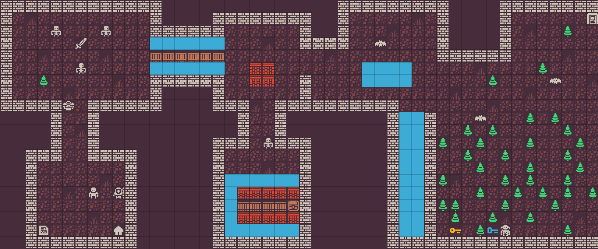
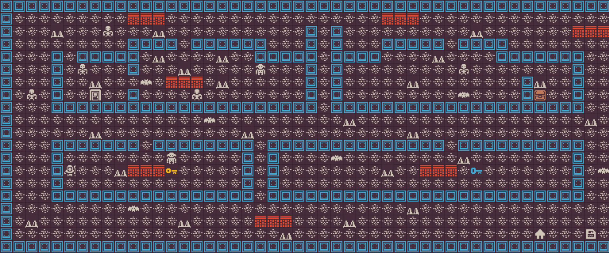
<h3>Dungeon Crawl</h3>

Team of 4 · 2 sprints

A JavaFX roguelike: fight bats, goblins and skeletons, dodge lava, loot chests and save your run to PostgreSQL.

<b>My contribution:</b> PostgreSQL save/load system, level design, special ability and map tests.

   

</td>
<td width="50%" valign="top">
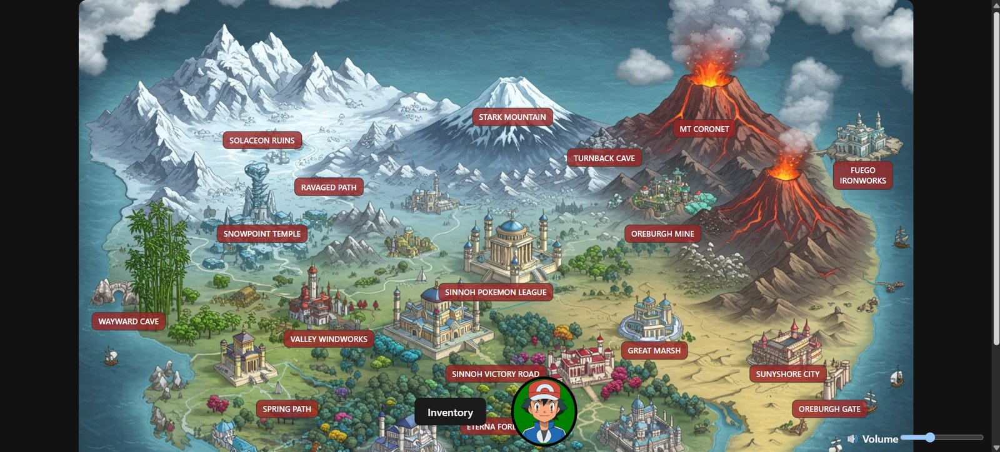
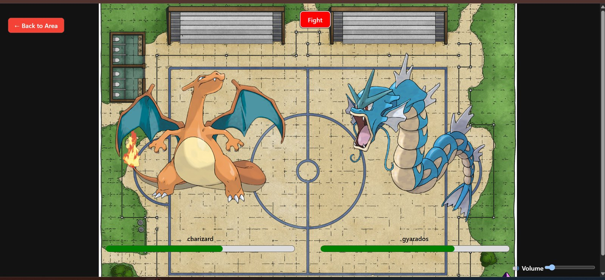 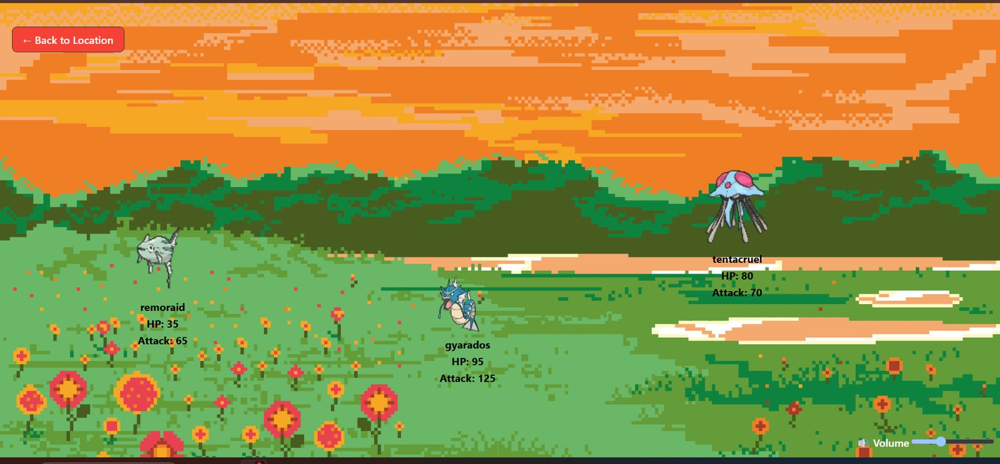
<h3>Gotta Fetch 'Em All</h3>

Team of 3 · 1 sprint

Explore the Sinnoh map, catch Pokémon from the live PokéAPI and battle them, with music and sound effects.

<b>My contribution:</b> the turn-based battle page and the PokéAPI data layer.

   

</td>
</tr>
<tr>
<td width="50%" valign="top">
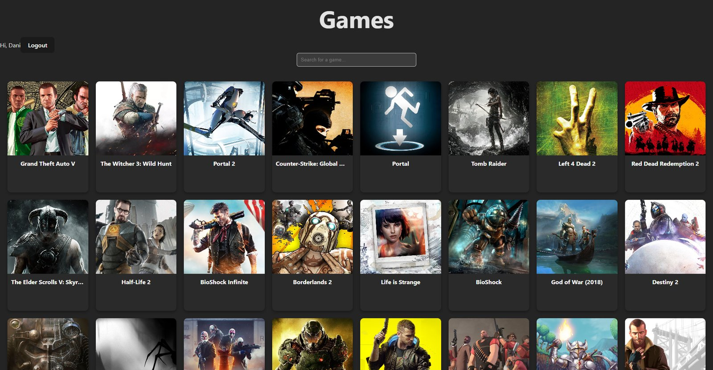
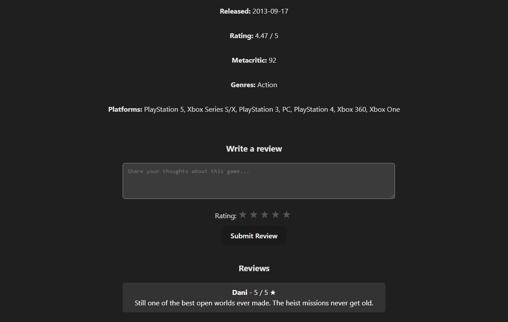
<h3>Video Games Database</h3>

Team project · 1 sprint

Browse thousands of games from the RAWG API with infinite scroll and live search, open any title for its details, and leave star-rated reviews after signing in.

<b>My contribution:</b> Firebase Auth sign-up/login and the search and filter UI.

   

</td>
<td width="50%" valign="top">
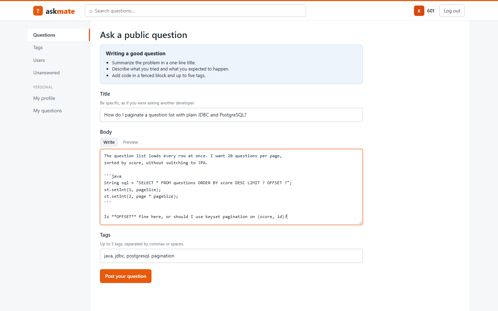
<h3>AskMate</h3>

Team of 3 · 2 sprints

A Stack Overflow–style Q&amp;A backend: a layered Spring Boot REST API for questions and answers, protected by token-based login.

<b>My contribution:</b> authentication with Spring Security and the answer DAO, covered by Mockito tests.

     

</td>
</tr>
</table>

### Smaller projects

<table>
<tr><th width="200">Preview</th><th>Project</th><th>My contribution</th></tr>
<tr><td>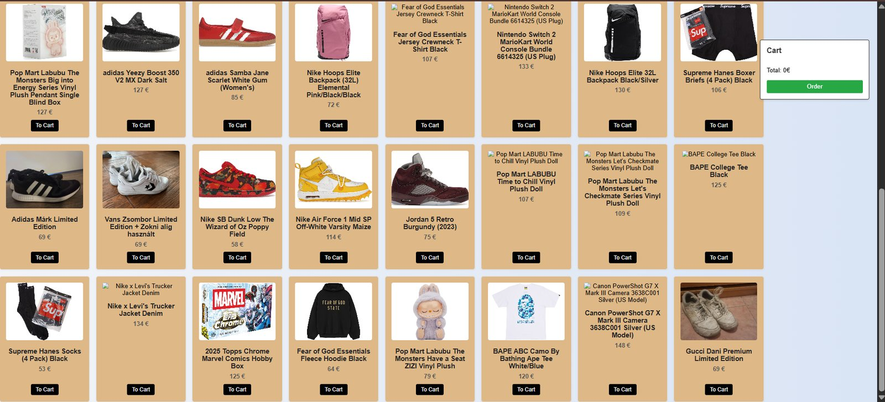</td><td><b>Online WebShop</b> Team of 3 · 1 sprint A sneaker and streetwear webshop with category filters, a cart and orders saved through an Express API, plus an admin page for editing products.   </td><td>the Express server setup and, in pair programming, order handling and the admin product editor.</td></tr>
<tr><td>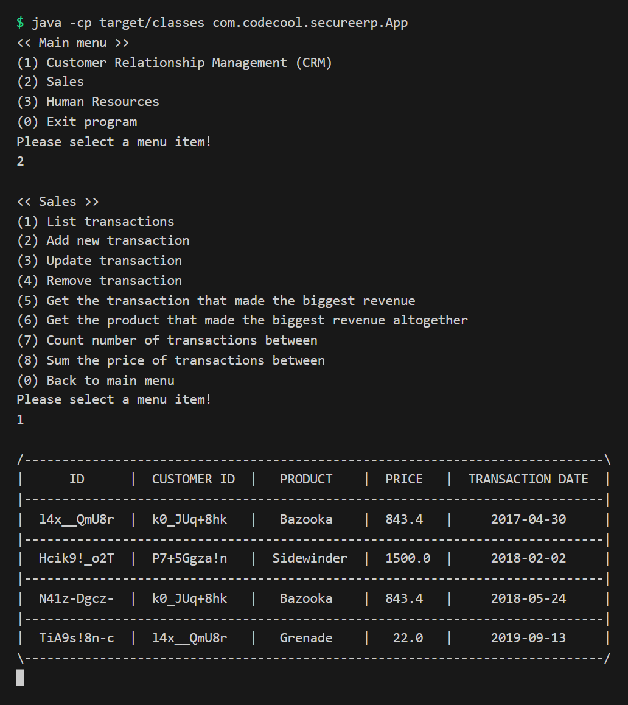</td><td><b>Secure ERP</b> Team of 3 · 1 sprint A console ERP with CRM, HR and Sales modules and role-based access levels, built on MVC and DAO layers.  </td><td>the Sales module: transaction CRUD and revenue reports, from controller to CSV-backed DAO.</td></tr>
<tr><!-- STATUS: uncertain, decide before publishing --><td>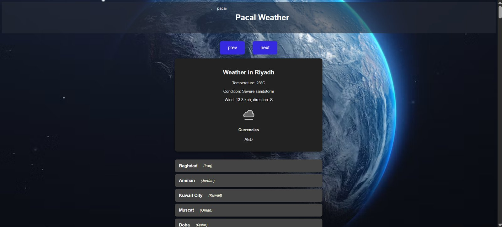</td><td><b>Weather Capitals</b> Team · Node + vanilla JS Live weather for the world's capitals on cards, fetched through a small Node backend.  </td><td>the API integrations (weather, currency, countries) and the card UI.</td></tr>
<tr><!-- STATUS: uncertain, decide before publishing --><td>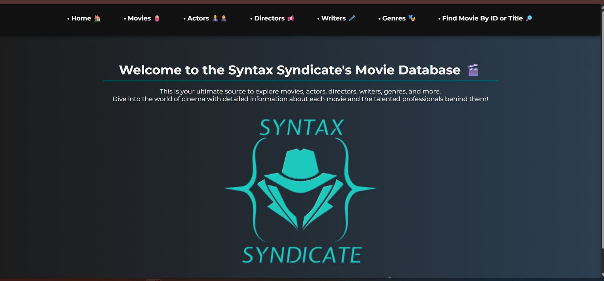</td><td><b>Movie DB Site</b> Team · Node + vanilla JS Browse movies, actors, writers, directors and genres, with filters by ID and runtime.   </td><td>the data processing in Node and all list and filter pages: movies, people, genres, by ID and runtime.</td></tr>
<tr><td>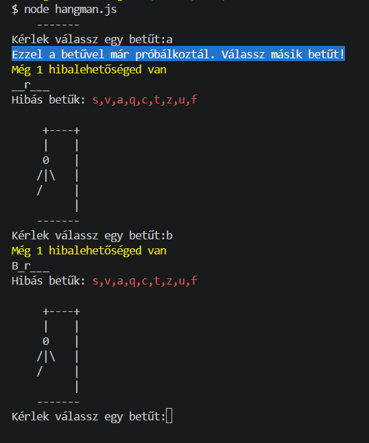</td><td><b>Hangman</b> Team · JS console Hangman in the terminal, with ASCII art and a word list of countries and capitals. </td><td>the game loop: difficulty levels, input validation and win/lose logic.</td></tr>
<tr><!-- STATUS: uncertain, decide before publishing --><td>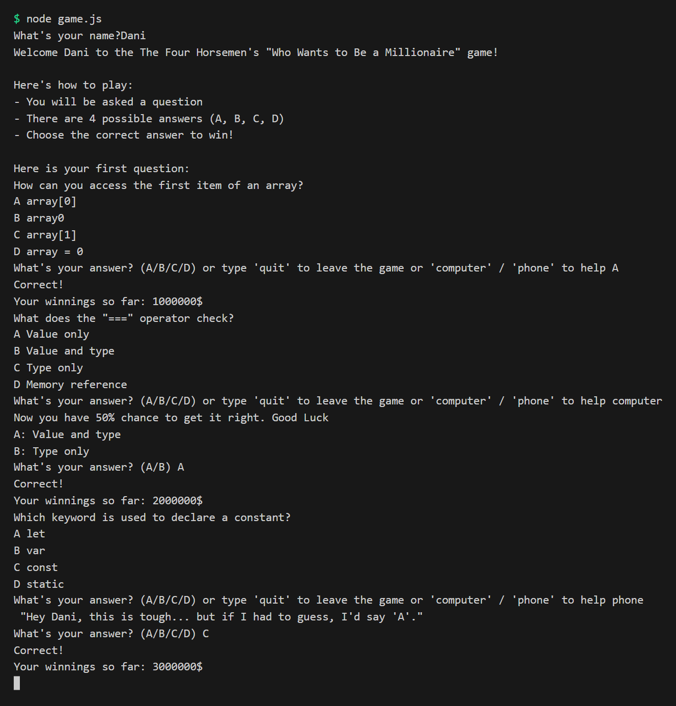</td><td><b>Billionaire Game</b> Team · JS console A &ldquo;Who Wants to Be a Millionaire&rdquo; quiz in the terminal, driven by a question bank. </td><td>the question bank and the prize ladder.</td></tr>
<tr><td>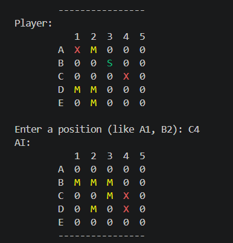</td><td><b>Battleship</b> Team · JS console Battleship on a terminal grid against an AI opponent. </td><td>ship placement and hit detection.</td></tr>
</table>

(<a href="#readme-top">back to top</a>)

---

## DevOps

Solo infrastructure projects: containers, Kubernetes and Terraform on AWS.
The largest one, a production-style EKS environment, has its own repository: **[eks-corp](https://github.com/KovyD20/eks-corp)**.

<table>
<tr>
<td width="50%" valign="top">

<h3><a href="https://github.com/KovyD20/k8s-infra">k8s-infra</a></h3>

Solo · Codecool DevOps module

Three Node.js microservices on Kubernetes, each with its own PostgreSQL, Secrets, health probes and autoscaling (HPA, 2–6 pods).

<b>My contribution:</b> Dockerfiles, Kubernetes manifests and service-to-service auth over cluster DNS.

    

<a href="https://github.com/KovyD20/k8s-infra">Repo</a>

</td>
<td width="50%" valign="top">

<h3><a href="https://github.com/KovyD20/whale-app">Whale App</a></h3>

Solo · Codecool DevOps module

A Dockerized Node.js app behind Nginx, deployed to AWS with Terraform: VPC, subnets, load balancer, EC2 and a private image registry.

<b>My contribution:</b> Terraform for VPC, ALB, EC2, ECR and IAM, plus the image build-and-push script.

    

<a href="https://github.com/KovyD20/whale-app">Repo</a>

</td>
</tr>
</table>

(<a href="#readme-top">back to top</a>)

---

## Personal projects (vibe coding)

Tools I design for my own daily work and build with Claude Code: I own the idea, the architecture and the review,
the AI writes most of the code and I fix them if neccesary.

<table>
<tr>
<td colspan="2" valign="top">
<h3><a href="https://github.com/KovyD20/DANIshBoard">DANIshBoard</a></h3>

Solo · dependency-free

My daily cockpit in one window: todos, projects, running Claude Code agents, calendar, mail and scheduled tasks, with a morning AI digest.

<a href="https://github.com/KovyD20/DANIshBoard">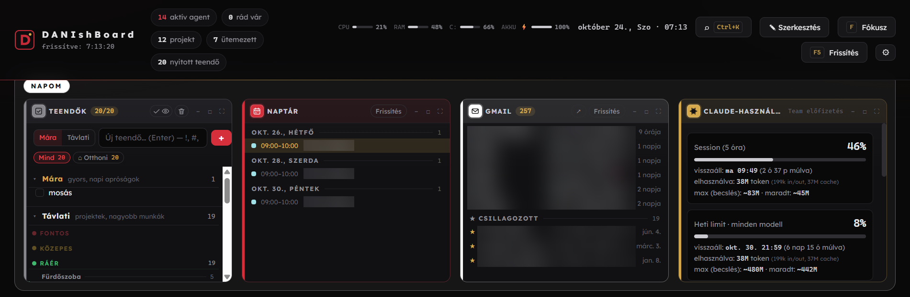</a>
<a href="https://github.com/KovyD20/DANIshBoard">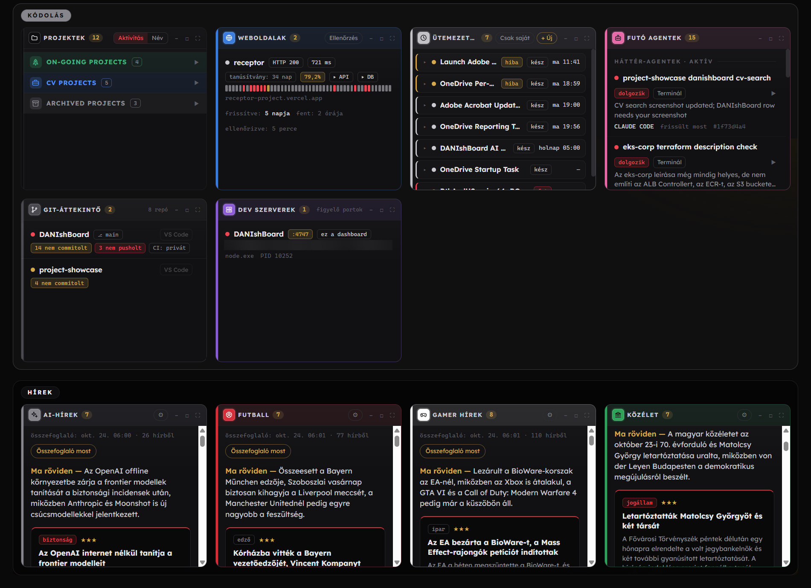</a>

<b>My contribution:</b> product idea, architecture, specs and code review; code written with Claude Code.

    

<blockquote>
<h4>↳ Sub-project: CV Search Dashboard</h4>

Solo · spin-off of DANIshBoard

A job-search tracker: Kanban for applications, job feeds scored against my profile, and AI-drafted cover letters and interview prep. DANIshBoard's <b>→ CV</b> button sends any calendar event or email straight to it.

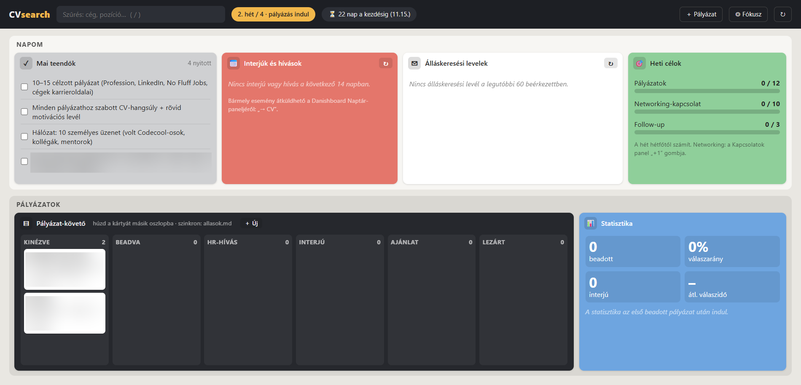
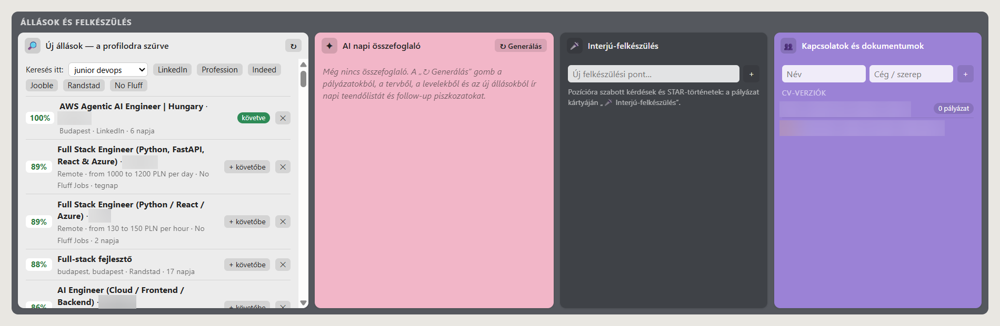

   

</blockquote>
</td>
</tr>
</table>

<!-- PLANNED: uncomment when the project exists.
<table>
<tr>
<td width="50%" valign="top">

<h3><a href="#">Ecosystem Simulator</a></h3>

Solo · Java OOP

Rabbits, foxes and grass on a grid: watch populations rise and crash, and genes evolve with every generation.

<b>My contribution:</b> product idea, architecture, specs and code review; code written with Claude Code.

 

<a href="#">Repo</a>

</td>
<td width="50%" valign="top">

<h3><a href="#">Logic Circuit Simulator</a></h3>

Solo · Java OOP

From NAND gates to a 4-bit adder and flip-flops: build circuits and print their truth tables.

<b>My contribution:</b> product idea, architecture, specs and code review; code written with Claude Code.

 

<a href="#">Repo</a>

</td>
</tr>
</table>
-->

(<a href="#readme-top">back to top</a>)

---

## How I work

- **Team projects:** Scrum-style sprints, daily stand-ups, pair and mob programming (VS Code Live Share),
  pull requests with code review, and a demo plus slides at the end of every sprint.
- **Personal projects:** AI-assisted development. I write the spec, split the work into small steps,
  review every change and keep tests green before anything is committed.

(<a href="#readme-top">back to top</a>)

